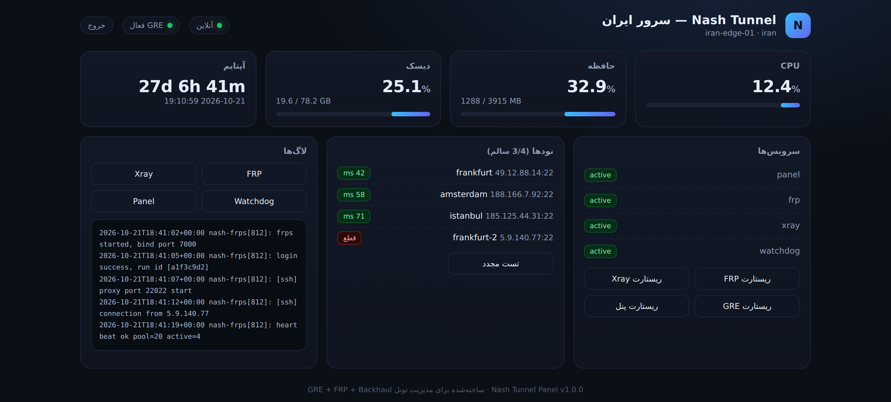

# Nash Tunnel

پنل و اسکریپت مدیریت تونل معکوس: **GRE + FRP + Backhaul (Xray) + Watchdog + Benchmark + Failover**

جایگزین کامل و متن‌باز برای پنل‌های تجاری این حوزه — بدون لایسنس، بدون قفل، بدون محدودیت تعداد سرور.

<p align="center">
  
</p>


```
┌──────────────┐        GRE (L3)        ┌──────────────┐
│  IRAN server │◄══════════════════════►│ FOREIGN node │
│  (public IP) │                        │  (public IP) │
│              │◄──── FRP (reverse) ────│              │
│              │◄──── Xray REALITY ─────│              │
└──────┬───────┘                        └──────────────┘
       │
   :8090 panel  ──►  dashboard / watchdog / logs / benchmark
```

## نصب سریع

```bash
curl -fsSL https://raw.githubusercontent.com/frank0live/nash-tunnel/main/install.sh | bash
```

> اگه نصب یک‌خطی رو از داخل یه اسکریپت اجرا کنی و ترمینال نداشته باشی، اسکریپت
> به‌جای گیر کردن، دستورای غیرتعاملی رو نشون می‌ده.

یا دستی:

```bash
git clone https://github.com/frank0live/nash-tunnel.git
cd nash-tunnel
bash nash.sh          # منوی تعاملی
```

## دستورات

| دستور | کار |
|---|---|
| `bash nash.sh status` | گزارش کامل سلامت (CPU/RAM/دیسک/سرویس‌ها/تونل) |
| `bash nash.sh install-iran` | نصب روی سرور ایران (GRE server + frps + پنل) |
| `bash nash.sh install-foreign` | نصب روی سرور خارج (GRE client + frpc + پنل) |
| `bash nash.sh backhaul` | ساخت سمت سرور Backhaul (Xray REALITY) |
| `bash nash.sh backhaul-client ...` | ساخت سمت کلاینت Backhaul |
| `bash nash.sh watchdog` | نصب/رفرش واچداگ (هر ۶۰ ثانیه) |
| `bash nash.sh benchmark` | تست پینگ/تاخیر همهٔ نودها و رتبه‌بندی |
| `bash nash.sh panel` | ریستارت پنل |
| `bash nash.sh uninstall` | حذف کامل |

## پنل وب

- آدرس: `http://SERVER_IP:8090`
- رمز در پایان نصب چاپ می‌شود (تصادفی ۱۴ کاراکتری)
- تغییر رمز: `bash nash.sh` → گزینه ۹
- امکانات: وضعیت زندهٔ CPU/RAM/دیسک/آپتایم، وضعیت سرویس‌ها، ریستارت تک‌کلیکی، تست زندهٔ نودها، لاگ‌ها، خروجی RTL فارسی

## Watchdog

سرویس systemd با تایمر ۶۰ ثانیه‌ای:

- سرویس‌های `nash-panel`, `nash-frps`, `nash-frpc`, `nash-backhaul` را چک می‌کند
- لینک `nash-gre` را چک می‌کند
- هر چیزی که افتاده بود را ریستارت می‌کند
- نتیجه را به تلگرام اطلاع می‌دهد (توکن/چت‌آیدی در `/etc/nash/config.json`)

## ساختار فایل‌ها

```
nash.sh                 اسکریپت اصلی (نصب/مدیریت/منو)
install.sh              نصب یک‌خطی
panel/panel.py          بک‌اند پنل (پایتون stdlib، بدون وابستگی)
web/index.html          فرانت پنل (تک‌فایل، RTL)
systemd/                یونیت‌های نمونه
/etc/nash/config.json   تنظیمات (پورت، نودها، تلگرام)
/etc/nash/panel.json    هش رمز و سشن‌ها
/etc/nash/frps.toml     تنظیمات FRP server
/etc/nash/frpc.toml     تنظیمات FRP client
/etc/nash/backhaul/     کانفیگ‌های Xray
```

## امنیت

- رمز پنل با PBKDF2-SHA256 (۱۲۰٬۰۰۰ دور) ذخیره می‌شود
- سشن با کوکی HttpOnly + SameSite=Strict، عمر ۱۲ ساعت
- توکن FRP و کلید GRE تصادفی تولید می‌شوند
- همهٔ فایل‌های حساس با مجوز `600`

پیشنهاد: پنل را پشت Nginx با TLS بگذارید یا فقط از IP خودتان باز کنید:

```bash
ufw allow from YOUR_IP to any port 8090
```

## عیب‌یابی

**منو فقط `! invalid choice` چاپ می‌کنه و لوپ می‌شه**
یعنی stdin به ترمینال وصل نیست (مثلاً `curl … | bash` یا اجرا از داخل یه ابزار).
از ۱.۰.۱ اسکریپت خودش به `/dev/tty` وصل می‌شه. اگه ترمینالی نبود، از دستورای
غیرتعاملی استفاده کن:

```bash
bash nash.sh status
bash nash.sh install-iran
bash nash.sh install-foreign
```

**`Job for nash-gre.service failed … invalid value for "key"`**
کلید تونل باید عدد باشه. تو نسخه‌های قدیمی با حروف ساخته می‌شد. بازتولیدش کن:

```bash
rm -f /etc/nash/gre.key
bash nash.sh install-iran      # کلید عددی جدید چاپ می‌شه
```

بعد تو سرور خارج **همون** کلید رو بزن. دو طرف باید یکی باشن وگرنه تونل بالا میاد ولی
ترافیک رد نمی‌شه:

```bash
cat /etc/nash/gre.key                 # باید تو دو سرور یکی باشه
ip -d link show nash-gre | grep ikey  # کلید فعال اینترفیس
```

**`Job for nash-backhaul.service failed` یا `invalid "shortIds[0]"`**
shortId باید هگز باشه (`0-9a-f`)، کانفیگ رو دوباره بساز (گزینه ۴ منو).

**پینگ TCP برمیگرده ولی ترافیک واقعی رد نمیشه (Real Delay = `-1ms` / timeout)**

توی معماری Relay/Core وقتی سمت خارج به یه سرویس روی **لوکالهاست خودش** فوروارد
میکنی (پنل 3x-ui، sshd، nginx) و پنل هیچ درخواستی ثبت نمیکنه — این رفتار خود
Xray-core است، نه کانفیگ تو:

از Xray **v26.4.17** به بعد (PR [#5947](https://github.com/XTLS/Xray-core/pull/5947))
خروجی `freedom` بهصورت پیشفرض ترافیک به آدرسهای **private/reserved** (از جمله
`127.0.0.1`) رو **blackhole** میکنه — سیاست امنیتی پیشفرض در برابر SSRF. پس تونل
REALITY سالمه، پکت به `127.0.0.1:2053` سرور خارج میرسه، ولی freedom قبل از dial
پکت رو میندازه و با `loglevel: warning` هیچی هم لاگ نمیشه:

```
proxy/freedom: blocked target: tcp:127.0.0.1:2053, blackholing connection for 47s
```

این خط فقط با `"loglevel": "info"` دیده میشه — دلیل اینکه «اتصال هست ولی دیتا
نیست».

مقصد `dokodemo-door` در سمت ایران هم در **انتهای تونل** (سرور خارج) تفسیر میشه،
پس `127.0.0.1` یعنی لوکالهاست سرور خارج و همین درسته؛ نیاز نیست IP عمومی خارج
رو بذاری.

از نسخهٔ ۱.۰.۲ اسکریپت این بلاک رو باز میکنه، پس اگه با نسخهٔ قدیمیتر کانفیگ
ساختی، سمت خارج `server.json` رو دوباره بساز:

```bash
bash nash.sh backhaul            # کانفیگ رو با finalRules جدید دوباره میسازه
systemctl restart nash-backhaul
```

اگه خودت دستی میخوای اضافهش کنی، `outbounds` سمت خارج باید این شکل باشه:

```json
"outbounds": [{
  "protocol": "freedom",
  "settings": {
    "finalRules": [
      {"action": "allow", "network": "tcp", "ip": ["127.0.0.1/32", "::1/128"]}
    ]
  }
}]
```

برای اینکه ببینی واقعاً مشکل همینه، موقتاً لاگ رو باز کن:

```bash
sed -i 's/"loglevel": "warning"/"loglevel": "info"/' /etc/nash/backhaul/server.json
systemctl restart nash-backhaul && journalctl -u nash-backhaul -f
```

## Support

- 💬 Telegram: [@master_supports](https://t.me/master_supports)

## لایسنس

MIT — آزاد برای استفاده شخصی و تجاری.
